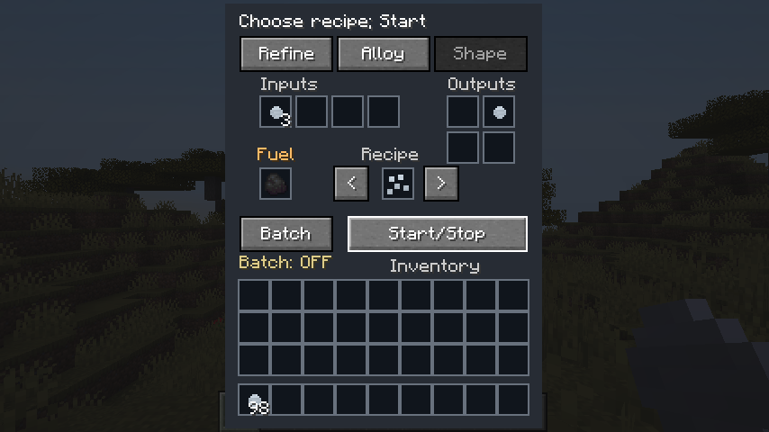
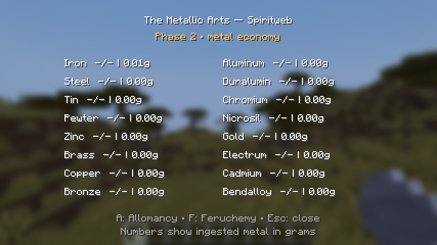

# Phase 2 validation

Verified October 31, 2026 (America/Denver), on Windows with Java 25, Minecraft 26.1, Loader 0.18.4, Fabric API 0.145.1+26.1, Loom 1.15.5 and Gradle 9.4.0.

| Check | Observed result |
| --- | --- |
| Common/client build and datagen launch | Passed |
| Unit tests | 22 passed, zero failures/errors |
| Server game-test runner | 16 required tests passed, including the Fabric framework test |
| Bundled ordinary recipes | All 325 executed in the test harness and conserved credited mass |
| Invested flaking | Three successive slices retained Identity and conserved both source mass and all charge, including the remainder |
| Brewing | One, two and three bottles consume one, two and three flakes; unused flakes remain; scarce flakes cannot fill extra bottles |
| Vanilla brewing regression | Water + nether wart still produces awkward potions |
| All sixteen metals | Typed vial creation tested for every standard metal |
| Unsafe inputs | Non-water, non-Allomantic and nonviable alloy inputs refused |
| Workstation safety | Blocked outputs consume neither ingredients nor fuel; a completed job consumes inputs once; specialty changes retain the block entity/inventory |
| Trading | Every specialty's five trade sets resolve; an unemployed villager found and claimed the table; invested trade inputs refused |
| Ore mining | All sixteen block variants have correct pickaxe tags and raw-ore loot |
| Natural generation | Client test found all eight ore families in nine newly generated normal Overworld chunks |
| End-to-end client workflow | Iron nugget → portions → flakes → actual Brewing Stand vial → bottle return → reserve; no power grant |
| Save/reopen | Ingested reserve and workstation contents/fuel retained across a full integrated-server close/reopen |
| Death-style player replacement | Actual PlayerList respawn path with KILLED reason retained the reserve |
| Dedicated logout/login | Existing foundation client test passed against the loopback dedicated server |
| Separate dedicated JVM restart | Seed process exited; second process reloaded player power/Identity/reserves, item charge/Identity, machine state and an interrupted brew |
| Interrupted jobs after restart | Metallurgy finished once with the expected 100 portions; brewing finished three vials and left two of five flakes |
| Player isolation | Two independent ServerPlayer instances retained separate Identity and reserve data |
| Visual check | Workstation slots/buttons/preview and the sixteen-metal reserve display inspected in actual game screenshots |

## Commands

```text
gradlew.bat build runClientGameTest -PacceptMinecraftEula=true --console=plain
gradlew.bat build runDatagen -PacceptMinecraftEula=true --console=plain
gradlew.bat runRestartSmoke -PsmokeMode=seed --console=plain
gradlew.bat runRestartSmoke -PsmokeMode=verify --console=plain
```

The restart smoke task is a test-mod-only harness under src/gametest. It needs its isolated build/run/restartSmoke/eula.txt and server.properties; the local run used accepted EULA and loopback port 25569. It writes explicit PASS/FAIL result files. Test classes and fixtures are not included in the installable mod.





## Limits

- Two simultaneous authenticated Minecraft clients and a long multiplayer soak were not tested. The isolation check uses two server-side player instances; the networking check uses one real local test client.
- The respawn test invokes the real server player-replacement path directly. It does not validate every possible death cause or a manual death-screen interaction.
- Ore generation was sampled in a normal world; extended survival balance, villager pathfinding in varied villages, long-run economic balance and third-party mod combinations need playtesting.
- Equipment is uncharged in normal gameplay. Identity/charge fixtures test preservation without claiming Feruchemy or Hemalurgy effects exist.
- Credited mass is a game abstraction. The tests do not assert real chemical ore composition, realistic item weights or thermodynamic yields.
- Runtime recipes and worldgen are data-pack editable; conservation checks cover the bundled definitions, not arbitrary server-authored recipes.
- Existing upstream development warnings remain: Java/mixin compatibility, deprecated APIs/build tooling, test-account profile-key/Realms authentication and an anisotropic-filtering option warning. These did not prevent the passing tests. This is not a warning-free log.
- Optional mixed-metal vials and later power systems remain unimplemented.

GitHub Actions independently builds, runs unit tests and launches datagen. It intentionally skips EULA-gated game tests. Local game-test results above are separate evidence; CI status is reported in the chat after publishing.
