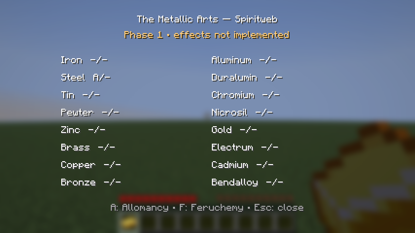

# Phase 1 validation

Verified locally on Windows with a Java 25 JDK, Minecraft **26.1**, Fabric Loader **0.18.4**, Fabric API **0.145.1+26.1**, Loom **1.15.5**, Gradle **9.4.0**. Results recorded October 31, 2026 (America/Denver).

| Check | Actual result |
| --- | --- |
| Common and client Java compilation | Passed |
| Unit tests | 15 passed, 0 failures/errors |
| Server game-test runner | 2 required tests passed (includes Fabric's framework test and the mod's attachment test) |
| Datagen | Entrypoint/empty provider pack launched and exited successfully; no content providers or generated gameplay claimed |
| Client game test | Passed with real rendered Minecraft client |
| Integrated-server persistence | Sample grant ID/source/strength, Identity and reserves retained across world close/server shutdown/disk reopen |
| Item persistence | Sample component on a vanilla gold ingot retained across that same disk reopen |
| Dedicated server | Started, accepted local client, sent owner snapshot, retained sample spiritweb on logout/login |
| UI | Screenshot inspected: all sixteen metals readable; sample Steel Allomancy visible; foundation notice readable |

Commands used:

```text
gradlew.bat build runDatagen -PacceptMinecraftEula=true --console=plain
gradlew.bat runClientGameTest -PacceptMinecraftEula=true --console=plain
```

The client test uses Fabric's isolated test world, closes and reopens it, and then starts a dedicated server restricted to `127.0.0.1:25568`. The test harness uses a development identity, not the user's Minecraft account. It shuts down its client/server after validation.



## Limits and diagnostic noise

- A separate dedicated **process** restart and long-running/two-player multiplayer soak test have not been performed. The tested dedicated lifecycle covers logout/login; the integrated lifecycle covers actual server shutdown and world reload. Do not claim every original roadmap acceptance scenario is verified.
- Copy-on-death is configured through Fabric but not exercised by a death/respawn test. Charged item transfer, duplication resistance and all magic effects remain unimplemented.
- The development client logs profile-key HTTP 401 errors because the game-test account is not authenticated; the local test connections and assertions nevertheless pass. This does not verify online-account authentication.
- The older pinned loader logs a Java 25 mixin compatibility warning and a no-remap-classpath warning; the tested Minecraft 26.1 launches pass. Initial game-test startup also logs creation of missing server properties. Gradle reports deprecations in upstream build tooling. These are retained as known diagnostics, not described as a clean/warning-free log.
- Initial setup caught invalid `Codec.longRange` calls, duplicate generated-resource declaration, the 26.1 GUI extraction rename, and sources/datagen task ordering. Those were corrected before the passing runs.
- GitHub Actions is configured to compile, run unit tests and datagen without accepting the Minecraft EULA. It skips server game tests; local game-test results above are separate evidence. Remote CI status is not implied by these local results.

The full original foundation milestone included every persistence scenario on dedicated multiplayer. This implementation establishes the Phase 1 code foundation and documents the remaining verification limits rather than calling later gameplay systems complete.
